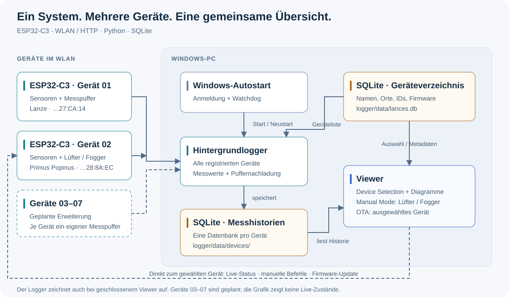
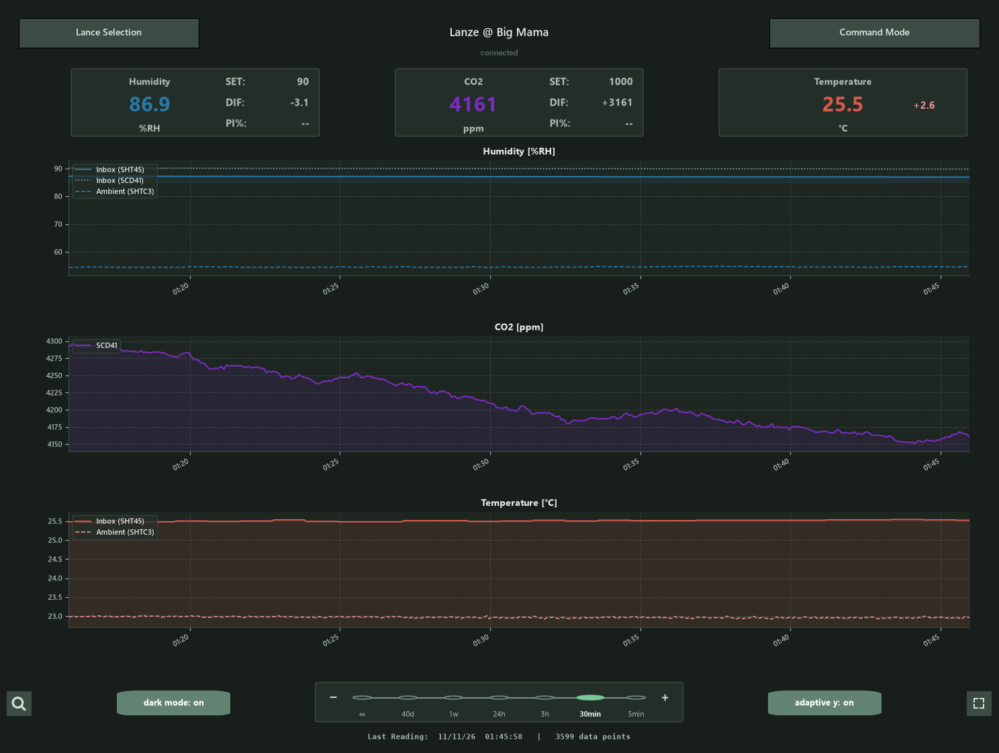
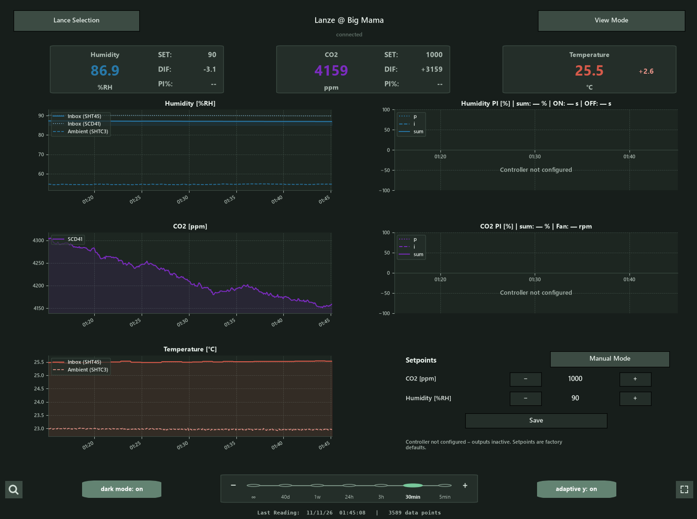

# fnc-fogger

**Mehrere Geräte messen. Der Logger zeichnet auf. Der Viewer macht die Daten sichtbar.**

Ein modulares System für CO₂-, Temperatur- und Feuchtemessung mit ESP32-C3
SuperMinis, dauerhafter Aufzeichnung und manueller Lüfter-/Fogger-Ansteuerung.

Einstieg: **[Dokumentationsübersicht](docs/README.md)** ·
[Architektur](docs/architecture.md) · [Geräteverwaltung](docs/device-management.md)

## Das System auf einen Blick

| Bestandteil | Aufgabe |
| --- | --- |
| **ESP32-C3** | Sensoren auslesen, Messwerte puffern und Lüfter/Fogger ansteuern. |
| **Hintergrundlogger** | Alle registrierten Geräte unabhängig vom Viewer aufzeichnen; verfügbare Puffer nachladen. |
| **SQLite** | Geräte zentral verwalten und Messhistorien pro Gerät getrennt speichern. |
| **Viewer** | Geräte auswählen, Daten darstellen, Ausgänge manuell bedienen und Firmware gezielt aktualisieren. |

Aktuell stehen Messung, Aufzeichnung, Manual Mode und OTA zur Verfügung.
Der Ausbau auf ungefähr sieben Geräte ist vorgesehen. **PI-Regelung ist noch
nicht implementiert.** Details zu Datenwegen und Betrieb stehen in der
[Architekturbeschreibung](docs/architecture.md).

## Anschlussplan

Der Plan und die [Hardwarehinweise](docs/hardware.md) beschreiben den aktuellen
C3-Aufbau: SDA GPIO0, SCL GPIO1, Lüfter-PWM GPIO5, Lüfter-Tacho GPIO6 und
MOSFET-Gate GPIO21. Sensoren werden mit 3,3 V versorgt; der Buck versorgt ESP32
und Fogger mit 5 V, der Lüfter bleibt an 24 V.

GPIO21 ist zugleich UART0-TX und kann vor dem Firmwarestart Bootsignale
ausgeben. Ein passiver Pull-down unterdrückt aktiv getriebene Bootimpulse nicht.
Beachte die [elektrischen Grenzen und Boot-Hinweise](docs/hardware.md).
Die tatsächliche Verkabelung muss zur installierten Firmware passen.

SCD41 misst CO2, SHT45 Temperatur und Feuchte; ein optionaler SHTC3 misst
Umgebungstemperatur und -feuchte am selben I²C-Bus. Fehlende Sensoren erscheinen
als fehlende Werte. Historische PT100-Daten bleiben in den alten Datenbanken.

## Start unter Windows

1. Abhängigkeiten installieren: `python -m pip install -r logger/requirements.txt`.
2. Einmalig Autostart und Überwachung einrichten: `powershell -File install_logger_autostart.ps1`.
3. Viewer öffnen: `powershell -File start_monitoring.ps1` oder `python logger/viewer.py`.

Der Logger startet bei Windows-Anmeldung und sammelt alle registrierten
Geräte unabhängig vom geöffneten Viewer. Die Windows-Überwachung startet ihn
bei Fehlern neu. Der PC muss angemeldet, wach und im Netzwerk sein.
Details: [Daueraufzeichnung und Wiederherstellung](docs/background-logger.md).

Gerätezuordnungen liegen in `logger/data/lances.db`, Messhistorien getrennt in
`logger/data/devices/<device-id>.db`. Beim Wiederverbinden werden verfügbare
Gerätepuffer mit rekonstruierten Messzeitpunkten nachgeladen. Die Kapazität
dieser Puffer ist begrenzt; bereits überschriebene Daten sind verloren.

## Viewer und manuelle Bedienung

### View Mode

CO₂, Feuchte und Temperatur als zeitliche Verläufe – mit aktuellen Messwerten,
wählbarem Zeitfenster und Vergleich zwischen Innenraum- und Umgebungssensoren.

### Command Mode

Messkurven neben Sollwerten und den vorbereiteten Reglerdiagrammen.
Über Manual Mode lassen sich Lüfter und Fogger getrennt bedienen.
Die Aufnahme zeigt den Stand ohne konfigurierte PI-Regelung.

Device Selection findet Geräte im WLAN. Name und Location lassen sich direkt
bearbeiten. Die Adresse öffnet die Geräte-Webseite; ein Klick auf die Geräte-ID
kopiert sie. Open Viewer zeigt die Messhistorie des ausgewählten Geräts.

Command Mode → Manual Mode bietet getrennte 0–100-%-Regler und On/Off-Buttons
für Lüfter und Fogger. Änderungen eingeschalteter Ausgänge werden direkt
übernommen. Stop All schaltet beide aus. Ohne Erneuerung durch den Viewer
beendet die Firmware manuelle Ausgänge nach 30 Sekunden. Der Hintergrundlogger
sendet keine Aktorbefehle. Die Bedienung setzt passende Firmware voraus.
Siehe [Manual Mode, Starttest und Regelungskonzept](docs/control.md).

## Firmware bauen und aktualisieren

1. `include/wifi-credentials.example.h` nach `../wifi-credentials.h` kopieren
   und die eigenen WLAN-Zugangsdaten eintragen. Die echte Datei nicht committen.
2. C3 bauen: `pio run -e esp32c3_supermini` oder kurz `pio run`.
3. Erstinstallation über USB: `pio run -e esp32c3_supermini -t upload --upload-port COMx`.
4. Spätere Updates in Device Selection mit Update Firmware auf das ausdrücklich
   ausgewählte Gerät laden; Geräte-ID, Hardwareprofil und Neustart werden geprüft.

BIN und Manifest werden als `firmware/fnc-fogger-firmware_<version>.bin` bzw.
`.json` exportiert. Die Dateien können WLAN-Zugangsdaten enthalten und bleiben
außerhalb von Git. [Firmwareordner](firmware/README.md).

Das frühere ESP32-S3-Profil bleibt als Legacy-Ziel verfügbar:
`pio run -e esp32s3`. Dafür erzeugte Dateien liegen unter `firmware/legacy/esp32s3/`.
Die Portenta-Ziele und ihre Build-/OTA-Hilfsdateien wurden entfernt; frühere
Stände sind in Git vorhanden. Keine Firmware wird durch einen Build automatisch installiert.

## Tests und historische Nachweise

Automatische Tests ausführen:
`python -m unittest discover -s test -p "test_*.py"`.

[Testübersicht und Ergebnisse](docs/maintenance/tests.md) trennt ausführbare
Regressionstests von historischen Versuchsberichten und Rohdaten.
Frühere Inbetriebnahmen und Messversuche stehen im [Archiv](docs/archive/README.md).
Entfernte Dateien und verbleibende Löschkandidaten:
[Dateiprüfung](docs/maintenance/file-review.md).
