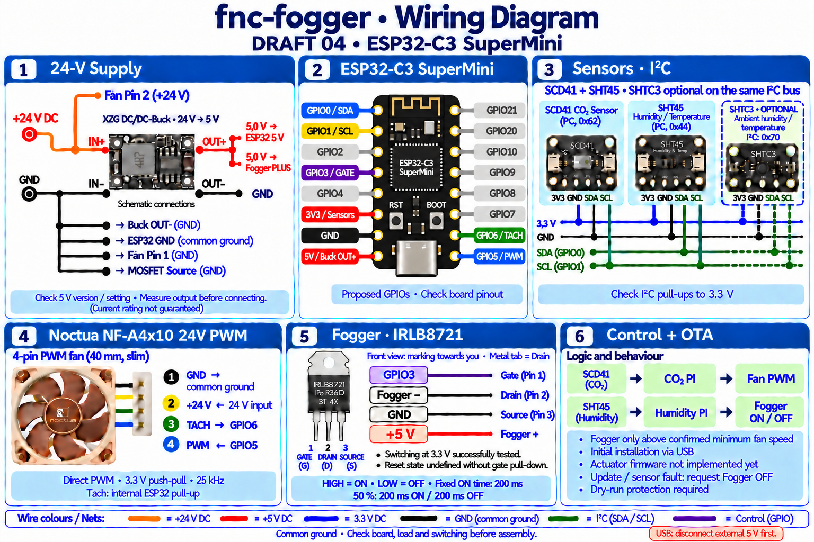

# fnc-fogger

## Authoritative wiring diagram

The **fnc-fogger draft 04** wiring diagram is the authoritative reference for
the planned ESP32-C3 SuperMini, sensors, fan and fogger assembly. It replaces
earlier diagrams. See [Hardware](docs/hardware.md) for connection tables and notes.

The plan uses SDA **GPIO0**, SCL **GPIO1**, fan PWM **GPIO5**, fan tach **GPIO6**
and fogger gate **GPIO3**. Sensors use **3.3 V**. An optional **SHTC3** measures
ambient humidity and temperature on the same I2C bus. The fan uses **24 V**;
the buck supplies the ESP32 and fogger with **5 V**. The existing ESP32-S3
uses SDA GPIO8 and SCL GPIO9. The additional `esp32c3_supermini` profile
prepares sensors and OTA on GPIO0/1; actuator control remains pending.

See [device management and first two SuperMini installations](docs/device-management.md)
for the device overview, firmware storage locations and targeted updates.

## Heater comparison, 2026-10-25

The SHT45 heater was temporarily disabled in `3.1.1-esp32s3-noheater`.
The user reported that the Inbox-minus-Ambient temperature difference fell
to zero. Firmware `3.1.2-esp32s3` restores the previous heater cycle.
See the [trial record](docs/sht45-noheater-trial-2026-10-25.md).

## Sensors since firmware 3.1.0

- Inbox: SHT45 for temperature and humidity; SCD41 for CO2 and the dotted humidity comparison curve.
- Ambient: SHTC3 (`0x70`) for ambient temperature and humidity, both drawn as dashed lines.
- The deployed ESP32-S3 still uses **SDA GPIO8, SCL GPIO9, 3.3 V**.
- SHTC3 is polled every five seconds and detected automatically when connected later. Without a valid reading, API, logger and viewer report missing values.
- The viewer starts with 30 minutes of history and adaptive scaling so readings outside previous chamber ranges remain visible.
- New SQLite/CSV fields: `temp_ambient_c`, `humidity_ambient_rh` and validity flags. Historical PT100 values remain in `temp_outer_c` and are not displayed as SHTC3 readings.

Protocol and conversion: [Sensirion SHTC3 datasheet](https://sensirion.com/resource/datasheet/shtc3).

## Current firmware

Current devices are ESP32-C3 SuperMinis. Build with `pio run` (default:
`esp32c3_supermini`). OTA files are exported as
`firmware/fnc-fogger-firmware_<version>.bin`, without device information in
the filename. Hardware compatibility metadata remains embedded in the image.

### Historical ESP32-S3 setup

Current target: **ESP32-S3-DEV-KIT-N8R8**, since 2026-10-24.
SHT45 and SCD41 use SDA **GPIO8**, SCL **GPIO9**, **3.3 V** supply.
PT100 has been removed from active firmware.

**Hardware test passed:** ESP32-S3 works with SHT45, SCD41, WiFi, LittleFS
measurement buffering and OTA. Operation without USB on an external 5 V supply
was verified. See the [2026-10-24 test](docs/esp32s3-hardware-test-2026-10-24.md).

The previous Portenta Machine Control state is marked by local Git tag
`portenta-machine-control-final` (`e215ccc`).
See [hardware migration and OTA](docs/hardware-migration-esp32s3.md).

## ESP32-S3 installation

1. Copy `include/wifi-credentials.example.h` to `../wifi-credentials.h` and enter WiFi credentials.
2. Build: `pio run -e esp32s3` (legacy target; default is now C3 SuperMini).
3. Initial USB installation: `pio run -e esp32s3 -t upload --upload-port COMx`.
4. Read the IP address with `pio device monitor --port COMx`.
5. For OTA on this legacy target, select the device in the viewer and choose `Update selected firmware` with the ESP32-S3 BIN under `firmware/legacy/esp32s3/`. CLI updates require `-Environment esp32s3`, `-DeviceUrl` and `-DeviceId`; see [device management](docs/device-management.md). Legacy S3 firmware requires its device-specific mDNS name for its first managed update.

Logger and viewer continue to work. Flash buffering now uses LittleFS.
The SHT45 heater cycle, sensor parameters and measurement intervals are retained.

## Historical Portenta documentation through 2.0.15

The following sections describe the previous assembly, including PT100, QSPI
and `.ota` format. Use the instructions above for ESP32-S3.

Measurement system for a climate chamber using Arduino Portenta Machine Control:

- SHT45 for Inbox temperature and relative humidity
- SCD41 for CO2 and a dotted humidity comparison curve
- One PT100 on channel 1 (formerly Inbox) for ambient temperature
- Local web page and QSPI recovery buffer
- Python logger with SQLite, CSV export, viewer and backup

## Installation

1. Copy `include/wifi-credentials.example.h` to `../wifi-credentials.h` and set `WIFI_SSID` and `WIFI_PASSWORD`. The real file remains outside the repository.
2. Check sensor parameters and channel assignments in `include/config.h`.
3. Build firmware: `pio run`.
4. Initial USB/DFU installation: `pio run -t upload`.
5. Install Python packages: `python -m pip install -r logger/requirements.txt`.

## Operation

Logger: `python logger/logger.py`.

Different IP: `python logger/logger.py --url http://192.168.31.168`.

The English naming convention in this revision makes the lance reachable via mDNS at
`http://fnc-fogger-<last six MAC characters>.local`, for example
`http://fnc-fogger-5cc8b4.local`. The name is stable when the IP changes.
PC applications discover DNS-SD service `_fnc-fogger._tcp.local`. SRV supplies
host and HTTP port; TXT contains `id` (full MAC without colons),
`path=/api/current` and `firmware`. Multicast must be allowed between PC and
lance. The service restarts after WiFi disconnections; failed starts are
retried every ten seconds. Portenta does not yet provide this discovery. Earlier ESP32 firmware uses a
legacy service name: update firmware and viewer together for automatic
discovery with the English name. No firmware is uploaded by this repository change.

An existing `measurements.csv` is imported into `measurements.db` once.
The QSPI backlog is recovered and deduplicated by `boot_id` plus `sequence`.
Firmware generates a hardware-random ID at each boot so a reset flash counter
cannot reuse old measurement keys. If randomness fails, the stored ID is the fallback.

SCD41 sensors can be replaced individually on the same connection (fixed
address `0x62`). After three intervals without valid readings, firmware
reinitializes and searches Wire and Wire1. Without a sensor, it searches every
five seconds. `scd_serial` in API and SQLite identifies the sensor. All units
use the same fixed offset from `config.h`; no automatic temperature adjustment
occurs. Never connect two SCD41 sensors to the same I2C bus simultaneously.

SHT45 connects through SDA, SCL, GND and an appropriate module supply,
address `0x44` in `config.h`. Firmware searches Wire and Wire1 independently
of SCD41. Their different addresses allow a shared bus. Outside heater/cooldown,
internal high-precision readings run every five seconds; the 10 ms conversion
is awaited in the main loop without blocking. CRC failures, missing and stale
readings become invalid, without substitution by SCD41 or PT100. The first
record can contain NULL before conversion completes.
Protocol and conversion: [Sensirion SHT4x datasheet](https://sensirion.com/resource/datasheet/sht4x).

## Firmware structure

- `SensorManager`: SCD41 and ambient RTD hardware access
- `Sht45Sensor`: independent, nonblocking SHT45 polling and CRC checks
- `MeasurementController`: timing, history and data flow
- `QspiStorage`: persistent measurement buffer and partitions
- `FirmwareUpdater`: OTA files, verification and activation
- `WebServer`: WiFi, HTTP API and UI delivery
- `Application`: explicit dependency wiring and orchestration

Sensor initialization, HTTP reception, OTA upload and backlog delivery run
incrementally in the main loop. Only necessary startup/reset delays block.

Viewer: `python logger/viewer.py`.

The viewer starts with lance selection, automatically discovers
`_fnc-fogger._tcp.local`, and lists saved offline lances. "Search again" repeats
discovery manually; automatic discovery runs every 15 seconds.
The overview also shows the firmware version without its hardware suffix,
device ID as an uppercase colon-separated MAC and last successful contact
(time only for today). Hardware/build metadata remains internal. Saved offline devices retain these
details. Updates target one explicitly selected online device and are verified
after restart. See [device management](docs/device-management.md) for persistence
and update history.
Install dependencies with `python -m pip install -r logger/requirements.txt`.

Double-click a Name or Location cell to edit it directly. Enter or leaving
the field saves; Escape cancels. Clicking Address opens the device in the
default browser. Opening the viewer or closing selection also saves edits in
`logger/data/lances.db`. Assignment uses the permanent device ID, not changing
IP. Charts show name and location at the top. "Home" returns to selection;
closing charts exits the viewer.

An existing `measurements.db` is assigned using the last stored SCD41 serial
number. Other lances have separate databases at
`logger/data/devices/<device-id>.db`. While charts are open, the viewer polls
the selected lance every five seconds and saves new readings. The standalone
logger remains usable for continuous recording independently of the viewer.

The top-right button switches "View mode" / "Command mode". Command mode
shows measurement curves on the left and Humidity/CO2 PI charts on the right
(-100 to +100%, time axis at 0%; dotted `p`, dashed `i`, solid `sum`, fixed
legends; blue humidity, purple CO2). Titles show current sum in %, measured
fan speed in rpm and fogger ON/OFF times in seconds. Units remain visible
when values are missing.

Below the PI charts, adjust setpoints with minus left and plus right, then
transmit with "Save". CO2: 0-5000 ppm in 500 ppm steps, then 1000 ppm steps
through 20000 ppm. Humidity: 70-100 %RH in one-point steps. Both modes also
show setpoints in the upper measurement cards as `SET:`, with `DIF:` (measured
minus setpoint) and `PI%:` (current controller output). Missing controller
values appear as `--`. The mode button names the destination mode. The centered
heading is `Lance name @ Location`. Values cannot be edited by typing.

Setpoints require ESP32 firmware 3.1.4 or later. Both values are committed
together as a versioned NVS blob before acknowledgement. Unchanged values
cause no extra flash writes. After restart they load before WiFi starts.
The viewer also stores confirmed values in `control_setpoints` in the lance's
measurement database. Device values are authoritative after reconnection;
PC cache values are not automatically written back. Offline edits are not
sent automatically later.

P, I and sum are buffered only in RAM while charts are open (at most 2160
live samples, about three hours at five-second intervals). They are not saved
to SQLite or CSV and have no retained history after closing the viewer.

The current measurement lance has no actuators or PI tuning. Outputs remain
disabled and PI fields report "Controller not configured". Setpoint storage,
display and future telemetry are prepared; autonomous control and hardware
drivers still need implementation. Entering Command mode activates no outputs.
See [Control concept](docs/control.md): only CO2 PI requests fan speed; the
fogger requires confirmed minimum fan speed and uses fixed 200 ms ON pulses.

CSV for Excel: `python logger/logger.py --export-csv`.

## Data quality

Sensor failures are stored as SQL NULL with validity flags and RTD error codes.
Uptime and sequence numbers expose restarts and gaps.

SCD41 ASC is disabled by default because a closed chamber is not regularly
exposed to 400 ppm fresh air. Each initialization writes the temperature
offset from `config.h` and reads it back. The existing offset comes from the
previous Box PT100 comparison and is retained. Comparing against SHT45 later
requires stable, comparable temperatures at both sites. Altitude is in
`config.h`. Operate without condensation.

SQLite stores corrected SCD41 temperature as `temp_scd_c` and the read-back
offset as `scd_temperature_offset_c`; old rows remain NULL there. Inbox
temperature (`boxtemp` / `temp_box_c`) and humidity (`humidity` / `humidity_rh`)
now come from SHT45. SCD41 humidity is separate: `scd_humidity` in API,
history and QSPI; `humidity_scd_rh` with `valid_scd_humidity` in SQLite/CSV.
Web and viewer draw it dotted. Databases are extended at logger startup.
Old readings retain their original source (Box PT100 or SCD41 humidity);
the new comparison column stays NULL for old rows. Old CSV remains readable.

PT100 uses three-wire compensation and a 50 Hz mains filter.
`configure_rtd_driver.py` patches the driver pinned to
Arduino-MAX31865 version 1.0.5 at build time: 50 Hz and 70 ms wait for single
conversions (up to 66 ms per datasheet). The downloaded library is unchanged.
Before each reading, three-wire mode and filter are reapplied and read back;
configuration is rechecked after conversion. A standalone MAX31865 reset
cannot silently leave lead resistance uncompensated. Failed checks invalidate
readings. API, QSPI and SQLite store raw ADC counts, before/after configuration
(`rtd_outer_config_before/after`) and `rtd_config_recoveries`, the cumulative
correction-attempt count since boot. Normal configuration is 17 (`0x11`:
three-wire, 50 Hz, bias off). This restores fixed settings, without temperature
calibration or changing the SCD41 offset.

Enable bounded comparison with `RTD_DIAGNOSTIC_SAMPLES` (0 = off).
`RTD_DIAGNOSTIC_TWO_WIRE` selects missing three-wire compensation instead of
60 Hz. Ordinary readings retain three-wire/50 Hz; comparison values are
separate in API/QSPI. Intentional mode changes also increase the correction
counter. Normal builds disable comparison. See the
[2026-09-09 investigation](docs/pt100-offset-2026-09-09.md).

## Persistence and backup

Portenta writes NDJSON to QSPI and rotates at 4 MiB. SQLite is the primary
long-term store. `backup.py` consistently backs up a running database.

## OTA and tests

Historical Portenta builds generate `firmware.ota`;
The historical Portenta web updater requires that format; the current
`upload_firmware.ps1` manages ESP32 targets only.
ESP32-S3 uses `firmware.bin` as described above.

Tests: `python -m unittest discover -s test -p "test_*.py"`.

## Regular operation since 2.0.13

There is no separate Inbox PT100. Old database columns and historical values
remain. Since 2.0.15, the only ambient PT100 is read on channel 1 (formerly
Inbox); channel 0 is no longer polled. Its ambient-temperature assignment in
API, database and viewer remains.

CO2, SCD41 humidity and ambient PT100 are recorded every five seconds.
SHT45 readings are accepted independently every 65 seconds. Between readings,
display and recording hold the last value with its offset.
`sht_read_uptime_ms` identifies the original acceptance time in API/QSPI/
SQLite/CSV; repeated values are not new SHT45 measurements. A failure at the
next scheduled reading replaces the old value with invalid data.

After a successful SHT45 reading, a heater pulse is requested: nominal 200 mW
at 3.3 V for one second, only with a fresh reading below 65 degrees C. After
the maximum heater conversion (1.11 s), at least 60 seconds of cooldown precede
the next normal conversion. Heated readings are not published as ambient
measurements. The main loop remains free. The first valid reading after
restart is unheated and uncorrected.

`humidity` / `humidity_rh` remain raw. Each measurement stores manual
`humidity_offset_rh` and `sht_heater_elapsed_ms` (time of SHT45 reading since
the end of maximum heater conversion) in QSPI/API/SQLite/CSV. Valid readings
at least 60 seconds after heater conversion receive +1.00 percentage point RH,
including delayed acquisition after 65 seconds. Before the first heater cycle
and on errors, no offset applies. This is a provisional manual correction,
not absolute calibration.

Web (`humidity_corrected`) and viewer (`humidity_corrected_rh`) show only raw
value plus stored offset, clamped to 0-100 %RH. No extra raw curve. SCD41 is
dotted, SHT45 solid. Historical readings without offsets remain unchanged;
fixed scales and adaptive scaling remain.

The completed 2.0.11 cooldown trial (six pulses 120 seconds apart, then heater
off) is documented in the [2026-09-24 heater test](docs/heater-test-2026-09-24/README.md).

## Viewer cache

History loads once at startup, then only newly appended database rows.
Without new data the viewer does not redraw. All points remain, including
individual spikes. CSV reloads only after file changes. Restart the viewer
if manually editing old rows while appending new ones.

## API since 2.0.14

The logger calls `/api/current` without history. `/api/measurement` retains
its content but streams history one point at a time from a fixed snapshot,
avoiding a huge JSON string that exhausts the heap and returns incomplete data
with full history. `/api/backlog/current` retrieves only the current QSPI file;
`/api/backlog` still returns the previous file as well.
