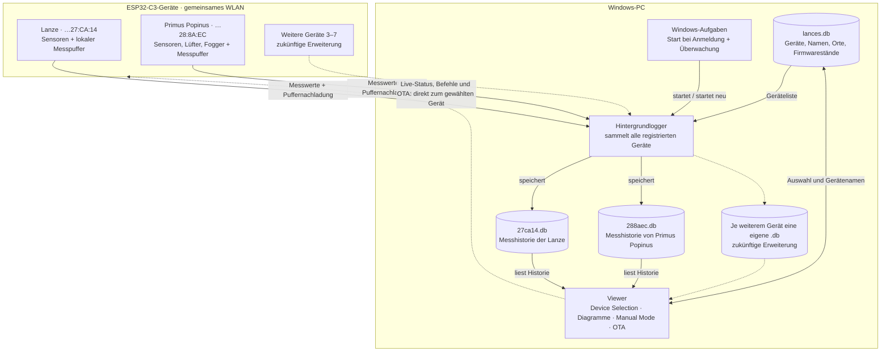

# Projektarchitektur mit mehreren Geräten

Stand: 11. November 2026. Die Grafik zeigt den implementierten Aufbau nach
Entkopplung von Logger und Viewer. Geräte 3–7 sind als zukünftige Erweiterung
markiert, nicht als bereits angeschlossene Geräte. Online-/Offline-Zustände
sind bewusst nicht Teil dieser statischen Architekturübersicht.

## Messdaten

Jeder ESP32 misst selbstständig und führt einen begrenzten lokalen Flashpuffer.
Der Hintergrundlogger fragt `/api/current` ungefähr alle fünf Sekunden ab.
Beim Start und nach Lücken lädt er verfügbare Werte aus `/api/backlog` nach.
Die Messdaten fließen vom Gerät zum Logger und dann in dessen eigene SQLite-
Datei. Ein nicht erreichbares Gerät blockiert die anderen Geräte nicht.

Die zentrale `logger/data/lances.db` enthält Gerätezuordnung, Namen, Orte,
zuletzt bestätigte Firmware-/Build-Metadaten und die OTA-Updatehistorie.
Sie enthält nicht die eigentliche Messhistorie. Diese liegt getrennt unter
`logger/data/devices/b81f3f27ca14.db`,
`logger/data/devices/b81f3f288aec.db` usw. Die Zuordnung bleibt auch bei
wechselnder IP oder geändertem Namen erhalten.

Pro Gerät enthält die SQLite-Datei Messungen (`measurements`), geschätzte
Boot-Zeitanker für Nachladung (`measurement_clocks`) und gegebenenfalls die
vom Viewer bestätigten Sollwerte (`control_setpoints`). Live-PI-Telemetrie
liegt im RAM des Viewers; manuelle Ausgänge liegen im RAM des ESP32.
Die archivierte `logger/data/measurements.db` gehört zur entfernten früheren
S3-Lanze und wird nicht mit den aktiven C3-Geräten vermischt.

## Viewer und Gerätebedienung

Der Viewer liest Messhistorien aus SQLite. Er schreibt keine Messungen und
sein Schließen beendet den Hintergrundlogger nicht. Device Selection liest
und aktualisiert die zentrale Geräteverwaltung; mDNS und Statusabfragen
finden beziehungsweise prüfen Geräte im WLAN.

Die gestrichelte Verbindung zum Geräteblock steht für den separaten direkten
HTTP-Pfad zwischen Viewer und jeweils ausgewähltem Gerät: Live-Status,
Sollwerte, manuelle Lüfter-/Fogger-Befehle und Firmware-Updates. Die physische
Ansteuerung erfolgt in der Gerätefirmware. OTA geht nur an das explizit
gewählte und anhand seiner ID geprüfte Gerät.

Der Logger steuert keine Aktoren. Insbesondere verlängert er keine manuelle
Freigabe: das bleibt Aufgabe des geöffneten Viewers. Ohne Erneuerung stoppt
die Firmware manuelle Ausgänge nach 30 Sekunden. PI-Regelung ist noch nicht
implementiert; Manual Mode und Starttest sind verfügbar, soweit die jeweilige
Gerätefirmware sie unterstützt. Der lokale Firmwarestand kann zwischen
Geräten unterschiedlich sein.

## Windows-Betrieb

`fnc-fogger-logger` startet bei Benutzeranmeldung; die Aufgabenplanung startet
ihn nach einem Absturz neu. `fnc-fogger-logger-watchdog` prüft zusätzlich alle
zwei Minuten den Prozess und seinen Heartbeat. Der Python-Supervisor prüft
seine Geräte-Worker alle zehn Sekunden. Die OS-Prozesssperre vermeidet mehrere
Hintergrundlogger für dasselbe Datenverzeichnis.

Der PC muss angemeldet, wach und mit dem Netzwerk verbunden sein. Während
einer Unterbrechung bleibt nur der begrenzte Geräte-Puffer; bereits
überschriebene Daten lassen sich nicht nachladen.

Details zu Betrieb, Dateien und Wiederherstellung:
[Hintergrundlogger](background-logger.md).

## Zuordnung zum Code

| Bestandteil | Implementierung |
|---|---|
| Messungen, Sensoren, HTTP-API und Aktoren | `src/firmware/`, `src/esp32/`, `include/firmware/` |
| Daueraufzeichnung aller registrierten Geräte | `logger/background.py` |
| Messzeit und deduplizierte Puffernachladung | `logger/measurement_recording.py` |
| Geräteverwaltung und Datenbankzuordnung | `logger/lance_registry.py` |
| Diagramme und Geräteauswahl | `logger/viewer.py`, `logger/viewer_selection.py` |
| Viewer-Live-Status und direkte Befehle | `logger/lance_collection.py` |
| Manuelle Bedienung | `logger/viewer_manual.py` |
| Windows-Autostart und Überwachung | `install_logger_autostart.ps1`, `check_logger.ps1` |
