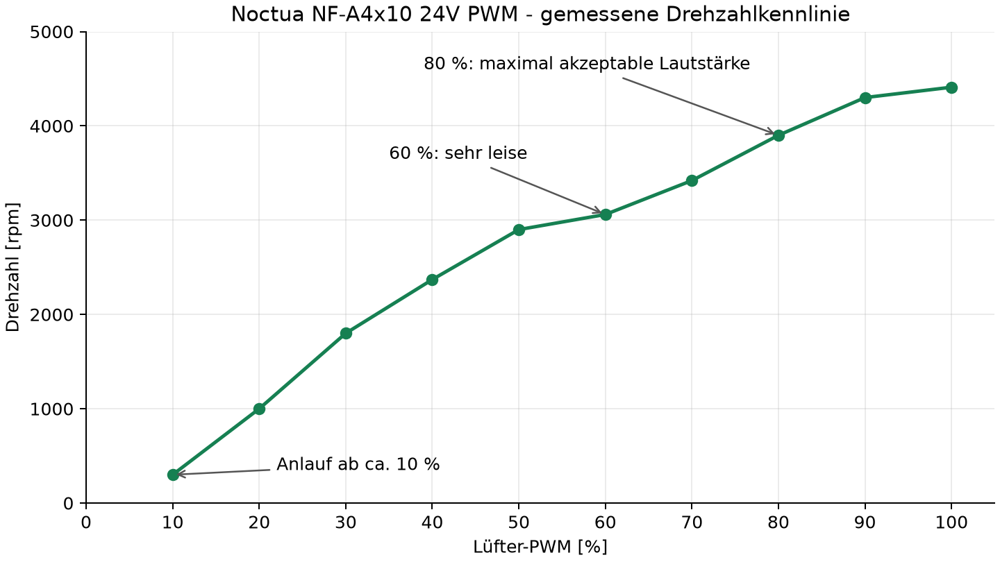

# Control concept

## Firmware 3.6.2: hold both PI loops during mist

During the ON phase, Cyclic Mist holds both CO2 and humidity P/I terms,
commands the fan to a fixed 50% and fogger to 100% (subject to the existing
sensor/fault and fan-RPM checks). Both loops resume with retained I and current
P when the mist phase ends. Mist duration is excluded from both integration
intervals, including a held sensor sample at the transition. The fan graph's
output label reports actual PWM rather than the held CO2 PI sum.

The minimum OFF duration is 10 minutes; choices are 10-60 in steps of 5.
Saved older pauses of 1-9 minutes migrate to 10 without disabling the cycle.
ON remains 0 (disabled) or 1-10 minutes. ON/value and OFF/value are each
centered between their minus/plus buttons. The frame and alignment are unchanged.

## Firmware 3.6.1: ON = 0 disables Cyclic Mist

Cyclic Mist is a single row in its own narrow frame attached directly below
the main controls: Cyclic Mist [min] | minus ON value plus | minus OFF value plus.
There is no separate toggle button. ON can be 0-10 minutes; ON=0 saves the cycle
as disabled. Selecting 1-10 enables it immediately. OFF remains 1-10 minutes,
then 15-60 in steps of 5. Disabled settings from 3.6.0 are displayed as ON=0.
Changing an already enabled cycle restarts its phase with the new duration.
The saved state, reboot behavior and WLAN-independent operation are unchanged.

## Firmware 3.6.0: persistent Cyclic Mist and 99% target

The maximum selectable calibrated humidity target is now 99% in firmware,
API and viewer. Existing PI gains and normal automatic output limits are unchanged.

Control Panel includes Mist Time (1-10 minutes, steps of 1), Mist Pause
(1-10 minutes, then 15-60 in steps of 5), and a Cyclic Mist On/Off
switch in one centered row below the CO2 and humidity settings. Edits apply directly and are
confirmed by the ESP32; there is no Apply button.

Enabling starts a mist phase immediately. During this phase the fogger runs
continuously at 100% (explicit cyclic override of the normal 50% PI cap).
The humidity P/I terms are held. During Mist Pause the normal humidity PI
resumes, recalculates P from the current measurement and retains I; mist time
is excluded from the next integration interval. CO2 PI continues throughout.
Existing sensor/fault and measured-fan-RPM handling still applies.

The ESP32 runs the nonblocking schedule without a viewer. Settings and the
On/Off state are saved atomically in NVS namespace `cyclic-mist`, key `settings`.
They remain enabled until explicitly switched Off. WLAN loss does not stop the
cycle or the associated automatic regulation. On reboot a saved enabled cycle
starts a new mist phase once automatic operation can start. Manual mode and
calibration temporarily take priority without disabling the saved cycle.
Firmware maintenance pauses outputs; saved cyclic settings survive the update.
First installation defaults to Off, 1 minute mist, 10 minutes pause.

API: `POST /api/control/cyclic-mist` with `enabled=0|1`, `mist_time_min`,
`mist_pause_min`; invalid steps and failed NVS writes are rejected without
changing the active configuration. GET `/api/control` and `/api/current`
report `control.cyclic_mist` (supported, enabled, minute settings, phase and
remaining_ms). The background logger records this JSON and actual fogger duty
in the device database's `control_samples`, independently of the viewer.

## Recorded setpoint lines

The viewer's humidity and CO2 sensor graphs show observed setpoints as green
dotted step lines labeled Setpoint. Temperature has no setpoint line.
The lines use recorded history rather than extending today's targets into the
past. Time-range selection, offline viewing and viewer restarts preserve the
historical values; missing history, recording gaps and reboots break the line.

The independent logger already stores targets on every live poll in each
device database, `control_samples.co2_setpoint_ppm` and
`control_samples.humidity_setpoint_rh`, plus `control_json.setpoints` and
`received_at`. Changes are recorded even when the sensor sequence is unchanged
or manual mode is active. `control_setpoints` holds only the latest confirmed
pair; it is not the historical source. No firmware or database migration is
required for these lines. Old sensor backfill cannot recreate past setpoints.

## Firmware 3.5.10: stronger proportional response

The evening-review proposal is now selected for both channels:

- CO2: **Kp: 4 %/100 ppm | Ki: 0.4 %/(100 ppm·min) | Ti: 10 min**
- Humidity: **Kp: 1.5 %/%RH | Ki: 0.1 %/(%RH·min) | Ti: 15 min**

CO2 P is doubled; humidity P is increased by 50%. Each integral gain Kp/Ti
is unchanged. Firmware stores CO2 Kp as 0.04 %/ppm, Ti as 600 seconds;
humidity Kp as 1.5 %/%RH, Ti as 900 seconds. Anti-windup, output caps
(fan 80%, automatic fogger 50%), the calibrated 98% humidity target ceiling,
and the removed condensation cutoff are unchanged. This is a trial tuning;
compare subsequent recordings before claiming improved settling or overshoot.
The firmware update resets integrals once at reboot and preserves setpoints
and humidity calibration. See the [evening review](maintenance/pi-review-evening-2026-11-12.md).

## Firmware 3.5.9: calibrated humidity target up to 98%

Humidity setpoints are limited to 70-98% in firmware validation, API and viewer.
The target uses the calibrated SHT45 value (raw RH plus the stored calibration
offset). Existing offsets are preserved. Automatic fogger output remains 0-50%.
The raw SCD41 >=95% condensation fault is removed. There is no high-humidity
cutoff or normal-overshoot PI reset; signed P and nonnegative I regulate output.
Existing invalid/stale sensor, network and fan-RPM handling remains unchanged.
Manual output and the 100% calibration routine are unchanged.

## Firmware 3.5.8: continuous PI with anti-windup

Automatic limits are fan 80% and fogger 50% (100 ms ON / 100 ms OFF at 50%).
Normal humidity overshoot, including the previous target + 0.5% threshold,
no longer clears P/I. CO2 PI also retains terms at zero output, without the
previous 50 ppm restart deadband. P may be negative. I stays within 0-80% for
CO2 and 0-50% for humidity. Actual output remains clamped to 0 through the
channel maximum. Positive integration is blocked when its candidate P+I sum
would exceed the output maximum. Negative error can always unwind I down to
zero, even at zero output, without building negative integral debt.
Gains and integral times are unchanged. Fan-RPM pauses still freeze humidity I.
Invalid sensors and the separate raw SCD41 condensation threshold (95% RH)
retain their existing fault/reset behavior.
Viewer PI axes span -20 to 100%; yellow horizontal lines mark the current
50% fogger and 80% fan limits. P terms outside the displayed range remain recorded.
Historical ranges retain their recorded terms; yellow lines show current limits.

Current implementation: [PI commissioning, firmware 3.5.8](pi-commissioning.md).
CO₂ ventilation PI and humidity PI are now enabled on the chamber device.
Humidity target is 90% corrected SHT45 RH; fogging requires valid measured
fan RPM above zero, including coast-down at zero PWM. Fan duty follows the
CO₂ PI over 0–80% without a minimum floor. The first ventilation-only revision
kept the fogger locked OFF.
Tuning is not established.
During normal zero/invalid-RPM fogger inhibition, the humidity integral is
frozen while actual fogger duty is zero. Resume recalculates P from current
humidity; integration excludes the pause, including any part of the next sensor
interval that preceded resume. Invalid/stale humidity, the humidity limit,
latched faults, Reset PI, mode changes and reboot still reset the integral.
The in-plot fogger percentage uses actual reported duty, so retained PI demand
does not falsely appear as active fogging during a pause.
PI is the default outside Manual Mode, including after reboot/reconnection with
valid sensors. Reset PI clears accumulated I terms; gains and fault latches stay.
The PI graphs show rounded PI sum at bottom centre, with fogger pulse times
or measured fan RPM. Display RPM rounds to 50 below
1,000 rpm and to 100 at or above 1,000 rpm. Stored telemetry is not rounded.
Command Mode allocates 60% of chart width to sensor plots and 40% to PI plots.
PI axes show 0–100%; negative P/I samples remain recorded but lie outside this
display range. Titles contain only channel and unit; the lower in-plot annotation
shows rounded PI sum plus fogger ON/OFF times or measured fan RPM. During a
fault, PI sum is unavailable and the annotation identifies actual fallback PWM.
PI curves now load recorded P, I and sum from the selected device's SQLite
`control_samples.control_json`, using observation timestamps converted to Zurich
time. The selected sensor-chart time range also filters the PI history, including
after reopening the viewer or while the device is offline. New rows append to a
read-only in-memory cache; faults, manual operation, reboot boundaries and gaps
longer than 15 seconds break the curve rather than suggesting continuous control.
The lower PI annotations and Kp/Ti describe the last observed record inside that
range. Live setpoints, buttons and status remain tied to the current device.
An empty historical range is labelled explicitly; no history is invented before
actuator logging began. Legacy databases without `control_samples` retain the
live-only display.

Viewer layout is fixed per device: `lances.actuators_installed` in
`logger/data/lances.db` selects Command Mode (true: installed fan and fogger)
or full-width View Mode (false: sensor-only). There is no view/command toggle.
New devices default to sensor-only. Provisioning or hardware changes update the
flag explicitly using `LanceRegistry.set_actuators_installed(device_id, bool)`;
discovery, firmware updates, label changes and address changes preserve it.
Currently b81f3f27ca14 is sensor-only and b81f3f27f4e0 has actuators installed.

On Windows, Device Overview and each new viewer window start in fullscreen on
the first non-primary monitor when available; otherwise they use the current
monitor. Escape leaves fullscreen and F11 toggles it without changing monitors.
Startup placement runs only once, after Tk has processed the initial layout.
Tk geometry handles monitor placement, including negative desktop coordinates,
without native resize calls that can crash Tk callbacks.
Device Overview preserves name/location capitalization and uses the viewer's
12-point Segoe UI Semibold title style.
Older version sections and the original design below provide historical context.

## Humidity reference adjustment, firmware 3.5.6

Manual Mode offers **Calibrate 15 min**. It commands 50% fan / 100% fogger
for 900 seconds on the ESP32, independent of the viewer remaining open.
**Cancel Calibration**, manual takeover, Wi-Fi loss and firmware update abort
without saving new offsets. Completion uses the latest valid, fresh raw SHT45
and SCD41 readings; invalid readings or storage failure retain previous offsets.
Completion returns to normal PI, subject to its existing fault handling.

This is an **assumed 100% RH reference adjustment**, not a traceable calibration:
visible ultrasonic mist does not establish exact vapor saturation at a sensor.
The SCD41 is specified for 0–95% RH, non-condensing. Its raw humidity still
drives the 95% condensation-risk guard; corrected display values do not bypass it.
Source: [Sensirion SCD4x datasheet](https://sensirion.com/media/documents/48C4B7FB/64C134E7/Sensirion_SCD4x_Datasheet.pdf).

Each absolute offset is `100 - raw_RH`. An existing offset is replaced, never
added. The original +1% RH SHT45 correction is superseded on the first adjustment.
Both offsets are committed together in device NVS (`humidity-ref/reference`).
Raw humidity stays unchanged in storage; each measurement carries its applied
SHT45 and SCD41 offset. Corrected display values are clipped to 0–100% RH.
Humidity legends show the latest offset for each sensor. Historical points use
their own recorded offsets; no historical measurements are rewritten.

The per-device SQLite database stores a separate `humidity_calibrations` table
with revision, observation time, assumed reference, raw readings, offsets and
duration. `reference_kind=assumed_saturation` distinguishes the assumption.
Full control telemetry also contains the current reference and timer status.
The maximum automatic humidity setpoint is **99% RH**, in viewer and firmware.
SHT45 regulation uses corrected humidity; the SCD41 RH is a comparison and
raw-value safety input, not the humidity PI feedback signal.

## First fogger commissioning (2026-11-12)

The fogger is in operation for the first time during manual commissioning.
Fan and fogger outputs are being tested manually before PI tuning. Live actuator
recording has been enabled; a verified snapshot shows 18% fan PWM, about
900 rpm and 16% fogger duty. Automatic PI control remains disabled.

## Manual Mode, firmware 3.4.0

Open the viewer's Command Mode, then select Manual Mode. Entry sets both
outputs to zero. Fan [%] controls the configured fan PWM duty from 0 to 100, rather than
closed-loop RPM; actual measured RPM remains visible in the CO2 graph title.
Fogger [%] controls a one-second time-proportioned cycle: 25% means 250 ms ON
and 750 ms OFF, 0% stays OFF, 100% stays ON. Each output has its own On/Off button.
Slider changes apply immediately to
enabled outputs; disabled outputs retain their local slider setting for the next
On press. Pending slider commands are coalesced to the latest position.
Stop All sends both outputs to zero; Exit Manual also stops both outputs.
PI stays disabled throughout. The manual test permits independent outputs,
including fogger operation without tach-confirmed airflow, for commissioning.
There is no water-level detection: supply water when testing the fogger.

Manual commands take over from the startup test and never resume it in the
same boot. Values exist only in device RAM and are not restored after reset.
The existing startup sequence still runs after a new boot until manual takeover.
Since firmware 3.4.7, manual outputs have **no command timeout**. Closing the
viewer or losing its HTTP connection does not stop outputs while the ESP32
remains connected to Wi-Fi. A device Wi-Fi disconnect stops both outputs and
latches them off; reconnect does not resume them. This includes short disconnects
followed by reconnection between application polls. Explicit manual commands
are needed to restart. Reboot discards manual values; existing startup tests
still run. Older firmware keeps its 30-second lease and viewer renewal.
OTA reception also stops both outputs. Timing is serviced without blocking;
late application polls can extend an individual fogger pulse.

`POST /api/control/manual` accepts a form with `mode=manual|off|renew`,
`fan_percent=0..100` and `fogger_percent=0..100` (whole percentages).
Mode off requires both values zero. Renew is retained for compatible clients
and acknowledges only an active command with identical values; it cannot restart
outputs after device reboot or Wi-Fi loss. `lease_ms=0` indicates no timeout.
The response and `/api/current` expose
`control.manual` with supported/active/fan_percent/fogger_percent/lease_ms;
`control.enabled=false` confirms that PI is disabled. Old firmware leaves
the manual controls unavailable. Manual observations are stored in SQLite by the
background logger; output commands are not restored from NVS after reset. This section is the reference for manual-mode behavior; code lives in
`manual_control`, `startup_actuators`, `control_api`, `viewer_manual`, and
`lance_collection`.

Verified on `b81f3f288aec`: firmware `3.4.0-esp32c3`, build `08564d7a1454`,
boot `2464235409`. Manual entry, renewal and exit confirmed with both outputs
at zero and PI disabled. Out-of-range commands and renewal after exit returned
HTTP 422. Final fan PWM 0%, measured RPM 0, fogger OFF. Nonzero operation is
left to the user's manual tests. All 93 host tests passed, including driver
PWM/gate output, duty timing, timeout, renewal, and direct viewer controls.

### Gate pin revision, firmware 3.4.1

The gate moves from GPIO3 to GPIO21 at the user's request. Manual controls,
fan GPIO5 and tach GPIO6 remain as above. GPIO21 can emit UART0 ROM boot
messages before the firmware requests LOW; a passive gate pull-down does
not suppress actively driven UART pulses. See hardware.md for the limitation.
Firmware is prepared for this new wiring; installation is deferred while the
previously overheated controller and wiring are being checked.

### Gate pin revision, firmware 3.4.2

The gate returns to GPIO3, avoiding GPIO21's UART0 TX boot output. Fan PWM
remains GPIO5, tach remains GPIO6, and startup/manual behavior is unchanged.
The firmware is prepared, not installed. Move the physical gate connection
to GPIO3 before installing this version. Check the previously overheated
controller and wiring before powering the assembly.

### Fan pin revision, firmware 3.4.3

Fan PWM moves to GPIO10 and fan tach to GPIO7. Gate GPIO3 and I2C GPIO0/1
remain unchanged. PWM is still non-inverted 25 kHz; tach retains its internal
3.3 V pull-up and two pulses per revolution. Startup and manual-mode timing
are unchanged. GPIO8 and GPIO9 remain unused boot configuration pins; see
[hardware pin assignments](hardware.md#proposed-gpio-assignments).
The image is prepared for manual OTA installation after rewiring; no device
is updated automatically. Earlier version-specific pin assignments below
remain historical.

## Implemented commissioning mode, firmware 3.3.2

The C3 now drives fan PWM on GPIO5 at 25 kHz, counts falling tach edges on
GPIO6 with the internal 3.3 V pull-up, and switches the fogger gate on GPIO3 in firmware 3.4.2
(GPIO21 in 3.4.1; GPIO3 in the original 3.3.x/3.4.0 releases).
Noctua specifies two tach pulses per revolution; RPM is calculated from the
actual pulse count and elapsed time in one-second windows.

On each restart, after the initial delay, the fan runs once for 3 seconds at
100%. Simultaneously the fogger pulses 100 ms ON / 100 ms OFF until the fan
returns to 0%. Both outputs then remain OFF. After a one-second pause the
test is marked complete. Nominally there are 15 fogger pulses; delayed polling
can reduce the count and extend individual phases. The fan deadline always
takes precedence over starting another fogger pulse. Rotor inertia means the
fan may continue turning after PWM reaches 0%.

The user explicitly allowed these startup-only fogger pulses without
tach-confirmed airflow or valid sensor readings and confirmed water readiness
on 10 November 2026. There is no electronic water-level check. This exception
does not enable humidity/CO2 control or waive the future control interlocks.
The startup test repeats after every reset, including an OTA restart.
OTA reception aborts the current test and requests fogger OFF and fan 100%;
the test does not resume until a new boot. PWM initialization failure prevents
fogger operation. Reset-time OFF still requires the external gate pull-down.

Telemetry under `control` reports `fan.rpm`, `fan.pwm_percent`, `fogger.on`,
and `startup_test.active/complete/completed_pulses/completed_fan_pulses`.
`completed_pulses` counts fogger pulses; the separate fan counter counts fan pulses. `enabled=false` refers
to the PI controller, not to the commissioning outputs. The viewer displays
the measured RPM in Command Mode and identifies commissioning separately.
Observed on `b81f3f288aec`: three completed pulses, fogger subsequently OFF,
fan at 100%, measured RPM 5160–5190, stable boot ID `1896208148`.
The user visually confirmed both original 3.3.0 startup tests successful.
The previous firmware 3.3.1 used three 2-second fan pulses and five 200 ms fogger pulses.
OTA verified on `b81f3f288aec`, build `3f3017286313`, boot ID `1965666641`:
startup complete, five fogger pulses and three fan pulses, fogger OFF afterward,
fan 100% with measured 5220 RPM. CO2, temperature and humidity readings valid.

Firmware 3.3.2 OTA was verified on `b81f3f288aec`, build `2a06017b4fb6`.
Subsequent HTTP status reads timed out, so completion and post-test tach RPM
could not yet be confirmed on the physical device. All 87 host tests passed,
including simultaneous timing, shutdown, delayed polling and OTA abort.

Sources: [Noctua PWM/tach specifications](https://www.noctua.at/pub/media/wysiwyg/Noctua_PWM_specifications_white_paper.pdf).

## CO2 to supply air

Control error = measured CO2 minus CO2 setpoint. A positive error increases
fan demand. Only the CO2 PI determines fan speed. At sufficiently low CO2,
it may request no air exchange and stop the fan. Retain the integral across
the setpoint and unwind with negative error; stop at zero calculated demand.
Output spans 0–80% without a minimum floor; anti-windup uses those limits.

ESP32 directly drives the Noctua NF-A4x10 24V PWM using non-inverted 3.3 V
push-pull PWM at 25 kHz. GPIO7 reads tach using the internal pull-up (firmware 3.4.3); no
external tach resistor is planned. Tach detects a stopped fan after a startup
grace period. The viewer displays measured tach RPM, never RPM inferred from PI output.

Supply air can lower CO2 only if its concentration is lower and an exhaust
path exists. Without a CO2 source, active increase is impossible. The setpoint
is therefore achievable only within physical limits.

Update the CO2 PI only with fresh valid readings. Initially plan a five-second
measurement interval for SCD41 standard operation; account for sensor and
chamber lag during tuning. Source: [SCD4x datasheet](https://sensirion.com/resource/datasheet/scd4x).
Use automatic self-calibration only when its fresh-air conditions are satisfied.

## Relative humidity to fogger

The humidity PI and fogger control must never request or increase fan speed.
The fogger may operate only when measured fan speed reaches the experimentally
established reliable minimum. When the CO2 PI requests no air exchange because
CO2 is sufficiently low, the fogger stays off regardless of humidity demand.
Immediately switch the fogger off below minimum fan speed. Account for this
interlock in humidity-PI anti-windup.

Control error = humidity setpoint minus measured humidity. Positive error
increases output between 0 and 100%. GPIO3 drives an IRLB8721 low-side switch
for the 5 V fogger supply (gate to GPIO3, drain to fogger negative, source to
GND; HIGH requests ON, LOW = OFF).

The fogger uses a fixed **200 ms ON time** and variable OFF time. For demand
p with 0 < p < 100: `off_time = 0.2 s * (100 / p - 1)`.
At 50%, alternate 200 ms ON / 200 ms OFF; at 10%, use 200 ms ON / 1.8 s OFF.
Do not switch fogger power at 25 kHz.

The fixed ON time was reduced from 2 s to 200 ms after the practical test on
2026-11-09. At 0%, stay off. At 100%, continuous operation requires explicit
support by the module. Protection shutdowns and the fan interlock act
immediately, including during an ON pulse. Timing must be nonblocking.

Acquire SHT45 readings at a fixed configurable interval. Update the PI only
with fresh valid readings and actual elapsed time. Ventilation also affects
humidity; tune controllers separately first, then together. Initially keep
D at zero; add it only if demonstrated useful, with a filtered measurement derivative.

## Fault and startup states

| Event | Planned response |
| --- | --- |
| Boot/reset, no valid readings yet | Request fogger OFF; without gate pull-down, OFF during reset is not guaranteed; initially run fan at full speed |
| SHT45 invalid or stale | Fogger OFF immediately; hold/reset humidity integrator |
| SCD41 invalid or stale | Configured fan fault speed (initially 100%); fogger OFF |
| Fan stopped despite speed demand | Report fault; fogger OFF |
| No water | Dry-run protection switches fogger OFF |
| Configured humidity upper limit exceeded | Fogger OFF independently of PI |

Define timeouts relative to sensor intervals. Restart only with valid readings
and cleared fault cause, using bounded, bumpless output. Fault states must stay visible.

## Fan measurements (2026-11-12)

Live RPM, fan PWM, fogger duty, mode and setpoints are now persisted by the
independent logger, including manual mode. See
[actuator recording](background-logger.md#actuator-recording-12-november-2026)
for timestamps, database columns and sampling limitations.

User-observed values for the Noctua NF-A4x10 24V PWM during manual testing:
the fan starts at approximately 10% PWM, reaching about 300 rpm.

| Fan PWM | Approximate measured speed |
|---|---:|
| 10% | 300 rpm |
| 20% | 1,000 rpm |
| 30% | 1,800 rpm |
| 40% | 2,370 rpm |
| 50% | 2,900 rpm |
| 60% | 3,060 rpm |
| 70% | 3,420 rpm |
| 80% | 3,900 rpm |
| 90% | 4,300 rpm |
| 100% | 4,410 rpm |

User's subjective noise assessment: **60% is very quiet**; **80% is the
maximum acceptable noise level** for the tested setup.

These are observations, not configured control limits. Repeatability of starts
and the minimum sustained speed of an already running fan remain to be checked.

## Pending experiment after fan installation

- [ ] With the real air path installed, determine the PWM command and measured speed at which the fan reliably starts from rest. Repeat multiple starts.
- [ ] Separately determine the lowest reliably sustained speed of an already running fan. Record startup and operating limits with margin.
- [ ] Verify that fogger enable requires tach-confirmed minimum speed and that stopped/slow fan conditions switch the fogger off.

## Firmware structure

Keep sensor access, hardware-independent PI logic, fogger pulse scheduling,
fan/load-switch drivers and state monitoring separate. Application connects
them through explicit dependencies. Use monotonic, nonblocking timing;
networking and UI remain separate modules.

Before hardware release, check reset outputs, sensor loss, fan stall, dry-run
protection, PWM polarity and minimum switching times. Tune PI only with the
actual chamber volume, air path and fogger.

## WiFi OTA updates

Sensor/OTA provisioning is prepared in the `esp32c3_supermini` build profile:
initial installation via USB, then targeted WiFi updates. See
[device management](device-management.md). Authentication and integration with
the planned actuator controller remain unimplemented.
The XZG buck continues providing 5 V during OTA; USB is unnecessary.

For the future actuator controller: before writing firmware, switch fogger off, hold both PI integrators and set
fan to the defined fault speed (initially 100%). After successful upload,
restart, initialize outputs and resume control only after valid readings.
Report aborted updates and control recovery. USB remains the recovery route.

Switching at 3.3 V successfully tested (2026-11-09, fogger module supplied at
5 V). Without gate pull-down, reset behaviour remains undefined; see
[electrical limits](hardware.md#limits-of-the-requested-resistor-free-variant).

## Cyclic Mist per hour (firmware 3.6.3)

The viewer offers one ON-time stepper: 0 (disabled) or 1-10 minutes per hour.
The pause is calculated as 60 minus the ON time, so 5 minutes means 5 minutes
of mist followed by 55 minutes of normal PI operation. Settings changes retain
both PI integrals and all PI gains. A changed schedule starts a new mist phase.
The API also retains support for legacy independent pause values; firmware 3.6.3
accepts integer pauses from 10 to 60 minutes. Existing saved schedules are
unchanged until the hourly setting is explicitly submitted. A firmware install
requires a reboot and therefore resets volatile PI state; do not install while
that state must be preserved.

## Firmware 3.6.4: humidity emergency and startup test

During automatic operation, a continuous valid, fresh calibrated humidity deficit
strictly greater than 10 percentage points for strictly more than 30 minutes
latches a humidity emergency. Invalid/stale humidity, recovery to the threshold,
or interrupted automatic operation clears the pending timer. Missing observation
intervals of 135 seconds or more do not count as continuous evidence.

The effective CO2 target becomes 5,000 ppm, with unchanged PI gains and limits.
The configured CO2 setpoint stays saved. Both cyclic-mist output overrides are
suspended while latched, so they cannot force the fan to 50%; normal humidity PI
continues subject to the existing sensor/RPM checks. The saved mist schedule is
retained. This is inferred humidification failure, not confirmed empty water.

The latch survives humidity recovery, setpoint edits and Reset PI. Restarting the
device or entering Manual Mode releases it; returning to PI starts a fresh
30-minute observation. Existing sensor and fan fault handling retains priority.

The API includes `humidity_emergency.active` and `co2_target_ppm`; the independent
logger records these in `control_samples.control_json`. Viewer warnings are bold
red. CO2 SET/DIF and recorded setpoint graphs use the effective target while the
editable Control Panel keeps the configured target.

Startup testing is enabled again: 1-second initial delay, one 3-second fan pulse
at 100%, concurrent fogger pulses of 100 ms ON / 100 ms OFF, then a 1-second pause.
An OTA installation restarts the device and resets volatile PI state.

## Firmware 3.6.5: tolerate brief fan tach gaps

At a commanded fan output of at least 10%, after the existing 5-second startup
allowance, missing/zero RPM must persist continuously for **more than 5 seconds**
before `automatic_fan_stalled` is latched. Exactly five seconds is tolerated.
Any valid positive RPM, output below 10%, or a new startup allowance clears the
pending stall timer. Brief gaps keep CO2 PI running and preserve its integrator;
the fogger is paused while RPM is absent, retaining its humidity integral.
Sustained stalls still use the existing 10% fault output and disable the fogger.
Installing this firmware restarts the controller and clears the previous latched
fault and volatile PI integrals; configured gains, targets and mist settings remain.

## Firmware 3.6.6: automatic sensor recovery and outage counters

Failed sensors are retried automatically without rebooting the ESP32. Healthy
sensors are not restarted periodically. SHT45 invalid scheduled readouts trigger
a soft reset (0x94); recovery readouts run every 5 seconds, with reset attempts
limited to once per 30 seconds. Normal 65-second readout and heater scheduling
resume after a valid reading. Heater/cooldown readings remain excluded.

SCD41 errors or a 15-second measurement timeout restart its initialization:
wake, stop periodic acquisition, wait, reinitialize (0x3646), wait, restore
settings and start acquisition. The stop/reinit wait states are nonblocking.
The ESP32 I2C peripheral is reinitialized at most once per 30 seconds during
SCD recovery; the shared SHT drivers are also restarted then. This is not a
physical sensor power cycle and cannot fix sustained electrical interference,
missing supply, or a slave holding a bus line indefinitely.

CO2 unavailability beyond the existing 15-second last-good-value window now
pauses automatic operation at fan 10% / fogger OFF and resumes on valid CO2.
Both PI integrals survive this pause. Missing humidity pauses the humidity PI
without clearing its integral. Recovery excludes the elapsed pause from PI
integration. Fan/hardware faults still latch; the humidity emergency remains
latched until its documented release. No PI gains or saved targets change.

`control.sensor_diagnostics` reports CO2/SHT45 outage episodes, restart attempts,
last failure/recovery uptime timestamps, I2C restart attempts, and SHT45 heater
activity/last heater-start uptime. One uninterrupted failure counts once;
repeated attempts count separately. Counters reset on ESP32 boot, not on sensor
restart. The viewer displays counts since boot under the Control Panel.
The background logger preserves the complete diagnostics in
`control_samples.control_json`, together with receipt timestamp, boot ID,
actuator duty and cyclic-mist state, allowing comparisons across reboots.

Command references: [SHT4x datasheet](https://sensirion.com/media/documents/33FD6951/662A593A/HT_DS_Datasheet_SHT4x.pdf),
[SCD4x datasheet](https://admin.sensirion.com/media/documents/48C4B7FB/64C134E7/Sensirion_SCD4x_Datasheet.pdf).

## Firmware 3.6.7: retain learned PI demand until explicit Reset PI

Manual/automatic transitions, Wi-Fi interruptions, sensor recovery, hardware or
fan faults, setpoint edits, and firmware gain changes no longer clear either
integral. Inactive periods freeze learned demand and are excluded from elapsed
integration time on resumption. P is derived from current error/current gain;
it is recalculated on resumption rather than restored as an old measurement.

The ESP32 saves both integrals as one versioned NVS record (`pi-memory`, key
`integrals`). Checkpoints run at most 30 seconds apart, with immediate saves on
control mode changes and during OTA maintenance (bounded 1-second write retry).
Unchanged snapshots do not write flash. Startup restores validated nonnegative
integrals within the existing fan/fogger output limits, regardless of firmware
Kp/Ti. A hard power loss can lose at most the last normal checkpoint interval;
no integration is performed for time while powered off. Flash failures are
reported through `control.pi_memory_saved` and a viewer warning; retries continue.

Only an explicit Reset PI clears learned demand in normal operation. The endpoint
first atomically saves zero; a failed write returns HTTP 503 without changing the
running integrators. Fan/hardware faults still require their existing release;
preserving their integrals does not automatically clear their fault latches.

`POST /api/control/pi-memory` accepts `co2_i` and `humidity_i` for explicit state
restoration/migration. Values must be finite and within 0..80 / 0..50 percent.
Both are persisted atomically before the live state is restored. This permits
migration from older firmware which had no NVS checkpoints: capture the old
live integrals before OTA, then restore them immediately after installation.
No gain/target/mist configuration is changed by a PI-memory restoration.

This section supersedes earlier descriptions of integral resets on mode changes,
faults, setpoint edits or firmware restart.

## Firmware 3.6.8: automatic fogger maximum 60%

Automatic humidity PI output and its integral ceiling are increased from 50% to 60%.
Existing PI integrals and tuning are retained. Cyclic mist and manual output still permit 100%.

## Firmware 3.6.9: retain cyclic mist timing across restarts

The device persists the UTC start of each cyclic mist period in NVS. After a
restart it skips the interrupted mist phase and waits until the next period is
due, rather than starting another mist immediately. Changes to the mist duration
preserve the period origin and both PI integrals. An overdue period starts once;
missed periods are not replayed.

Clock recovery is nonblocking, using NTP or the logger/viewer X-Unix-Time header.
Until a valid clock is available, cyclic mist waits; ordinary PI control continues.
Without an earlier saved start, the initial wait is one full period. The migration
endpoint POST /api/control/cyclic-mist-phase accepts last_start_unix to restore a
known earlier start from recorded telemetry. This does not change PI memory.

## Firmware 3.6.10: automatic fogger maximum 100%

Automatic humidity PI output and its integral ceiling now allow 0-100%.
At 100%, the fogger remains continuously on. Fan maximum remains 80%.
Existing PI integrals, tuning, setpoints and the persisted cyclic mist origin are retained.

## Firmware 3.6.11: one-minute settling after cyclic mist

Each scheduled mist ON phase is followed by 60 seconds with both fan and fogger
commanded OFF. Both PI controllers retain their P/I terms throughout misting
and settling, then resume without integrating the paused time. Settling is part
of the existing hourly pause: successive cycle starts remain one hour apart.
The viewer shows "cyclic mist active" above both actuator summaries during the
mist and settling phases, including recorded historical views. Reset PI only
clears the integrals; it never starts or reschedules cyclic mist.

## Firmware 3.6.12: sensor fallback also works after a cold start

Automatic mode no longer waits indefinitely for its first valid CO2 reading.
After the 15-second boot grace period, missing/invalid/stale CO2 enters the
existing recoverable fallback: fan 10%, fogger OFF, both PI integrals retained.
Valid measurements resume PI automatically. Manual mode, update maintenance,
unavailable actuator hardware and the existing network policy retain priority.
CO2 sensor failure also takes priority over scheduled cyclic mist settling;
settling cannot turn the 10% fallback fan off while the sensor is absent.

Verified on Lilith by OTA with both sensors physically removed: without sending
a manual enable command after restart, the device entered automatic_co2_invalid,
commanded fan 10% (observed approximately 300 rpm), and kept fogger OFF.
Restored integrals remained CO2 40.79% and humidity 19.30%. ESP32-C3 build and
all 170 automated tests passed.
