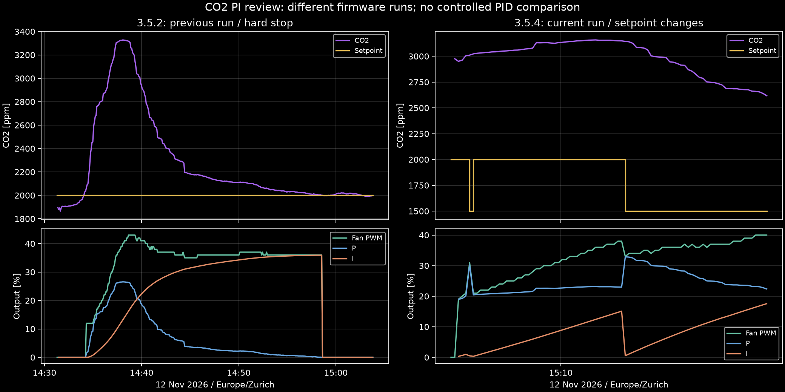

# CO2 PI: assessment of derivative action, 12 November 2026

Recommendation: retain PI for now. No controller parameters were changed.

Source: local `logger/data/devices/b81f3f27f4e0.db`, `control_samples`
joined to `measurements` by boot ID and sequence. Missing measurements are not
interpolated. Times below are Europe/Zurich. The review snapshot ends around
15:14; the logger continues recording.

## Observations

- The 3.5.2 run peaked at 3,328 ppm at 14:38:03 with 40% fan duty.
  It then approached the 2,000 ppm target without a repeated sustained
  oscillation. From 14:45 to 14:55 the average fall was about 14 ppm/min.
- At 14:58:37, reaching exactly 2,000 ppm reset both integrators and switched
  the fan from 36% to zero. This was explicit switching logic, not evidence
  that derivative damping was missing. Revisions 3.5.3/3.5.4 removed that reset
  at the setpoint; 3.5.4 also removed minimum fan duty.
- The 3.5.4 run started around 15:07:32. The setpoint briefly changed to 1,500
  and back to 2,000 ppm, then changed to 1,500 ppm at 15:11:27. Setpoint
  changes currently reset integrators, so the corresponding output jumps
  cannot be treated as an undisturbed response.
- In the final two-minute snapshot the measured CO2 trend was approximately
  -173 ppm/min while fan output increased from about 36% to 39%. Positive
  remaining error still accumulates I while P decreases. This can motivate
  later damping analysis, but does not establish an unsuitable Ti or a need
  for D: the new target had not yet been reached.
- Earlier runs include firmware changes, manual operation and the old
  sensor-fault fallback. They cannot be pooled as repetitions of one tuning.

## Interpretation and next observation

Derivative action could reduce ventilation earlier during a rapid CO2 fall,
and increase it earlier during a rise. It cannot remove an unknown transport
delay or distinguish a real concentration change from sensor interference.
Numerical differentiation amplifies measurement noise; any trial should use
a filtered derivative of measured CO2, exclude setpoint jumps, and reset filter
state after missing samples or reboot. No Td value is justified by these data.

Keep firmware, target and physical setup unchanged for at least 30–60 minutes,
and longer if necessary to observe multiple slow cycles. Assess repeated
overshoot/undershoot, output phase and settling before deciding between PI
retuning and filtered D. This duration is an observation proposal, not a
guarantee of adequate identification. No automatic future review is scheduled.

Reference: [MathWorks: differentiation amplifies noise; differentiator filtering](https://www.mathworks.com/help/signal/ug/take-derivatives-of-a-signal.html).
