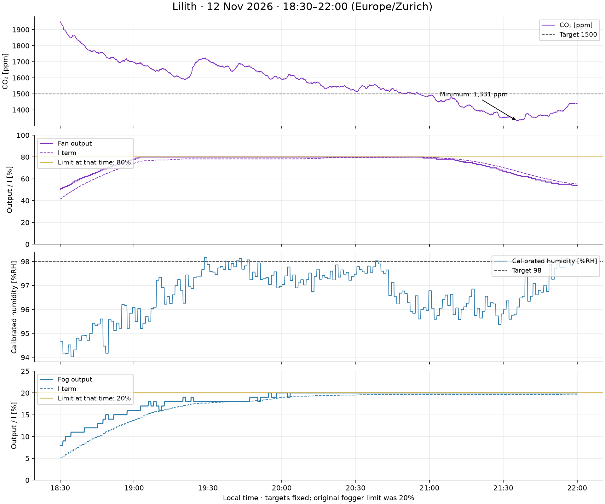

# PI review: 12 November 2026, 18:30–22:00

Recommendations only. No controller parameters or firmware changed in this review.
All times are Europe/Zurich (UTC+1). Source: read-only snapshot of
`logger/data/devices/b81f3f27f4e0.db`, 2,512 control samples from
17:30:00 through 21:00:00 UTC, end exclusive. Sensor values in the chart come
from measurements joined by boot ID and sequence; no interpolation is used.
Humidity is raw SHT45 plus the recorded calibration offset. Repeated held
humidity samples are retained; fresh SHT45 readings are typically 65 s apart.

## Recorded behavior

One uninterrupted boot, automatic mode throughout, no recorded fault or
controller mode change. Targets: CO2 1,500 ppm; humidity 98% calibrated RH.
Parameters: humidity `Kp: 1 %/%RH | Ti: 10 min`;
CO2 `Kp: 2 %/100 ppm | Ti: 5 min`. Limits then: fan 80%, fogger 20%.

- CO2 starts near 1,949 ppm. Fan reaches 80% at 19:02:03 and stays there
  through 20:57:15, with one further brief 80% interval. It is saturated for
  about 55% of the review period. Parameter changes cannot provide more
  ventilation while the output is already at its maximum.
- CO2 first reaches/breaches 1,500 ppm at 20:48:49. Five-minute averages
  cross around 20:55. It later bottoms at 1,331 ppm at 21:35:29 (169 ppm,
  11.3%, below target). At about 21:35, I is still 67.2% and fan duty 64%.
  By 21:59 fan duty has fallen to 54%, I to 55.42%, and CO2 is near 1,439 ppm.
  This suggests integral-dominated rundown; it does not establish a unique
  plant delay or exclude changing biological load or sensor effects.
- Humidity spans approximately 94.02–98.16% during this exact interval.
  Fogger stays at 20% from 20:03:25 to the end, and is at the cap for about
  58% of all samples. Around 20:45–21:30 humidity remains around 96%, despite
  full allowed fogger output. This is principally an output-limit issue,
  not evidence that humidity integration should be faster.
- The humidity reset at 22:01:37 is outside this review interval and was
  caused by the old target+0.5% cutoff, as separately verified. It must not
  be interpreted as natural PI settling.

## Proposed first trial, not a proven optimum

CO2: **Kp: 4 %/100 ppm | Ti: 10 min**

This doubles direct P response while preserving the old integral rate:
a held 100 ppm error still changes I by 0.4 percentage points per minute
outside saturation. A 100 ppm deficit immediately subtracts 4 rather than
2 points from fan output. Expected benefit: stronger correction of excursions
and more damping near target without faster positive I accumulation.

Humidity: **Kp: 1.5 %/%RH | Ti: 15 min**

This raises direct P response by 50%, while preserving integral rate:
a held 1% RH error still changes I by 0.1 percentage point per minute.
Do not shorten Ti merely to force more fogging: the newer 50% limit already
provides substantially more headroom than the 20% limit in these records.
First observe humidity with the new cap and removed cutoff before applying
this optional humidity adjustment.

These are measured-data-informed trial settings, not identified-model tuning.
Higher proportional gain is not a guarantee of less overshoot when transport
lag and changing loads are unknown. Apply CO2 first; keep humidity tuning
unchanged initially to avoid confounding coupled ventilation/humidity effects.
Compare similar load and target over at least a similarly long observation
window; the measured slow cycle extends well beyond one hour. Assess time
outside target bands, peak undershoot/overshoot, sustained oscillation, and
time at output limits. No reduction in settling time can be quantified from
this single closed-loop run. No derivative term is recommended from this run.

## Parameter units and presentation

Future proposals use `Kp: ... | Ki: ... | Ti: ...`, with CO2 in `%/100 ppm`, humidity in
`%/%RH`, and Ti in minutes. Internally firmware uses CO2 %/ppm and Ti seconds:
proposed CO2 Kp 0.04, Ti 600 s; humidity Kp 1.5, Ti 900 s.
Since integral rate is Kp/Ti, scaling both by the same factor preserves it.

Reference: [MathWorks: anti-windup and actuator saturation](https://www.mathworks.com/help/simulink/slref/anti-windup-control-using-a-pid-controller.html).

### Integral gains in readable units

| Channel | Recorded settings | Proposed settings |
| --- | --- | --- |
| CO2 | Kp: 2 %/100 ppm · Ki: 0.4 %/(100 ppm·min) · Ti: 5 min | Kp: 4 %/100 ppm · Ki: 0.4 %/(100 ppm·min) · Ti: 10 min |
| Humidity | Kp: 1 %/%RH · Ki: 0.1 %/(%RH·min) · Ti: 10 min | Kp: 1.5 %/%RH · Ki: 0.1 %/(%RH·min) · Ti: 15 min |

For the standard proposal format, separate Kp, Ki and Ti with vertical bars.
Ki = Kp/Ti; the proposed Kp/Ti pairs preserve each channel's integral gain.
